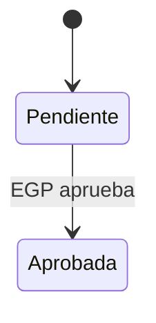

# Plantillas de entregables documentales

Leer en el Paso 6, una vez. Ambos documentos se escriben en
`AI-Outputs/po-poc-builder/{slug}/` y se copian a `docs/` del repo de la POC. Fuente:
el brief confirmado + lo realmente construido (si difieren, manda lo construido).
Lenguaje de negocio, segunda persona con voseo, sin jerga técnica.

## A. `manual-usuario.md` — guía breve de uso (2–4 páginas)

```markdown
# Manual de uso — {Producto} · POC {versión}
{Cliente} · Actualizado: {AAAA-MM-DD}

> Prueba de concepto con datos ficticios. Lo marcado como "En construcción" muestra
> funcionalidades previstas para el producto final.

## 1. Cómo ingresar
- Link: {pagesUrl}
- Usuarios de prueba:
| Perfil | Usuario | Contraseña | Qué puede hacer |
- Atajo: **Ingresar en modo demo** (entra como administrador) o tocar un usuario de la
  lista de la pantalla de login para autocompletar.

## 2. Recorrido por la pantalla
Menú lateral (secciones), barra superior (búsqueda, notificaciones, origen de datos,
perfil), panel de demo (botón flotante de la esquina inferior izquierda).

## 3. Cómo recorrer cada flujo principal
### FP-01 — {Nombre} (≈ {N} minutos)
**Usuario sugerido:** … · **Dónde:** menú › …
1. Paso con el botón o dato exacto a usar ("elegí la factura 001-001-0002001").
2. …
**Qué deberías ver:** resultado esperado y cambio de estado.
**Probá también:** variante de error o rechazo y el mensaje que aparece.

## 4. Panel de demo
Escenarios guiados, cambio de usuario y **Restablecer datos de demo** (vuelve todo al
estado inicial; usalo antes de cada presentación).

## 5. Qué está simulado
Tabla corta: funcionalidad · cómo se comporta en la POC · cómo sería en el producto.

## 6. Preguntas frecuentes
- ¿Los cambios los ven otros? (nube vs. local según el chip de la barra superior)
- ¿Puedo romper algo? (no: restablecer datos)
- Olvidé la contraseña / no puedo entrar.

## Historial de versiones
| Versión | Fecha | Cambios |
```

## B. `flujos-funcionales.md` — especificación detallada

```markdown
# Flujos funcionales — {Producto} · POC {versión}
{Cliente} · Actualizado: {AAAA-MM-DD} · Brief: poc-brief.md

## 1. Resumen
Tabla: FP · nombre · actor · resultado de negocio · ruta en la POC · escenario demo.

## 2. Actores y permisos
| Rol | Descripción | Permisos | Usuario de prueba |

## 3. Flujos
### FP-01 — {Nombre}
| Campo | Detalle |
|-------|---------|
| Objetivo de negocio | |
| Actor(es) | |
| Disparador | |
| Precondiciones | |
| Postcondición / resultado | |
| Pantallas | `#/ruta`, `#/ruta/{id}` |

**Flujo principal**
1. El usuario … → el sistema …

**Flujos alternativos y de error**
- FA-01.1 {condición} → {comportamiento y mensaje exacto}

**Reglas de negocio**
- RN-01.1 …

**Diagrama**


**Datos involucrados:** colecciones y campos.
**Criterios de aceptación**
- Dado … cuando … entonces …

**Simulado en la POC vs. producto final:** qué es mock y qué requeriría integración.

(repetir por FP)

## 4. Máquina de estados consolidada
Tabla de transiciones de todas las entidades.

## 5. Componente IA (si aplica)
Capacidad, datos de entrada, lógica simulada, explicación mostrada, validación humana,
métricas que habría que medir en el piloto.

## 6. Módulos en construcción
| Módulo | Capacidades previstas | Prioridad sugerida |

## 7. Supuestos, pendientes y próximos pasos
Supuestos ⏳ vigentes, preguntas abiertas para el cliente y recomendación de siguiente paso
(ej. PRD con po-prd-generator o historias con po-expert-user-stories).
```
