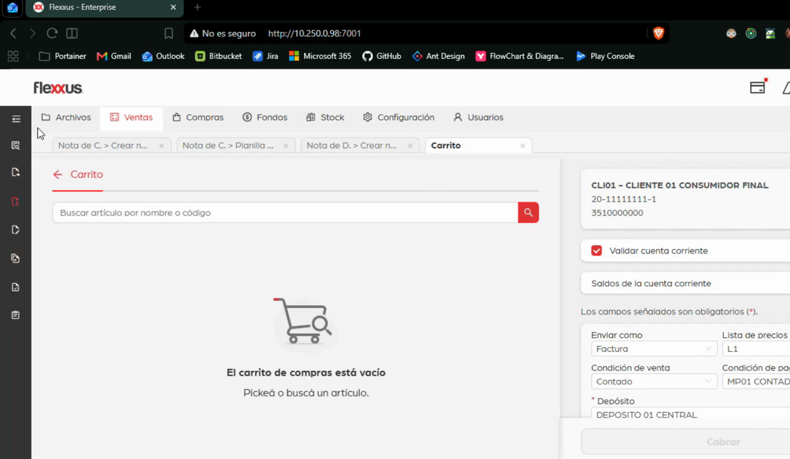
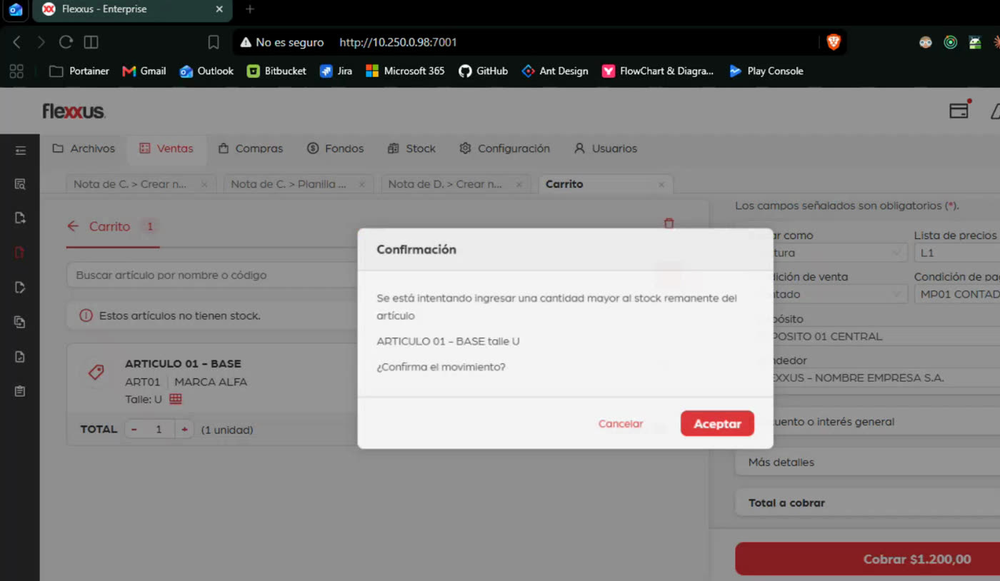
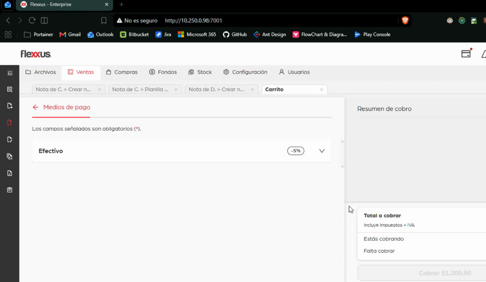
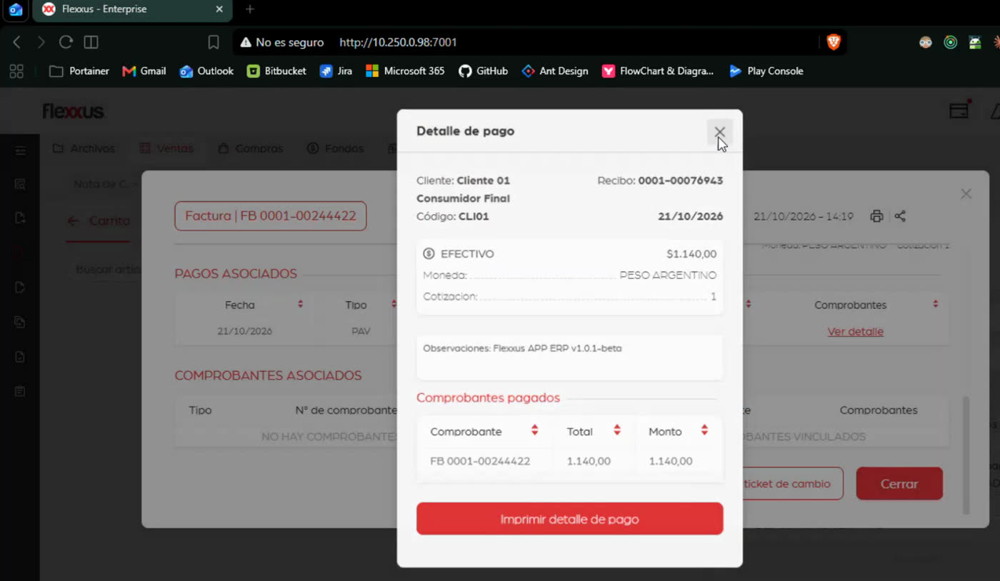
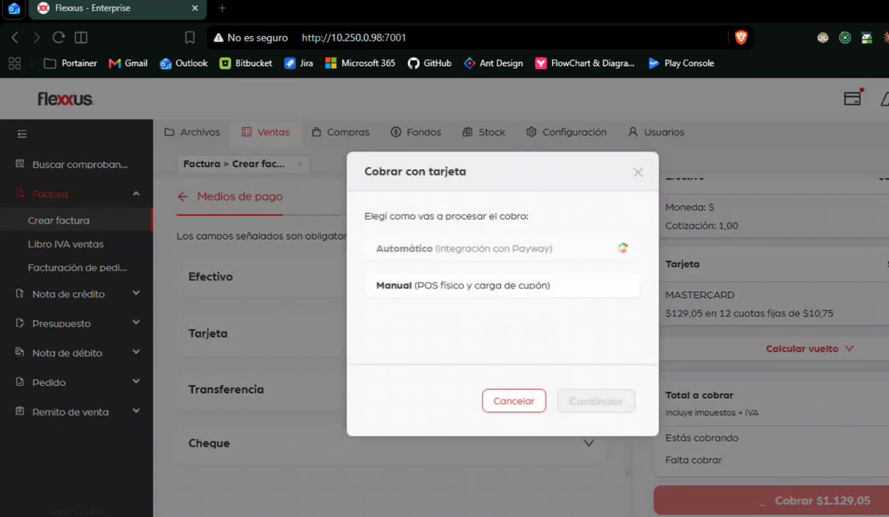
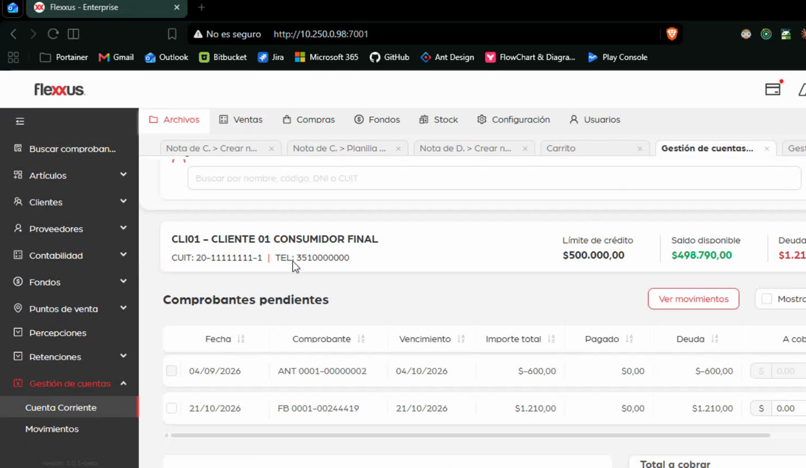
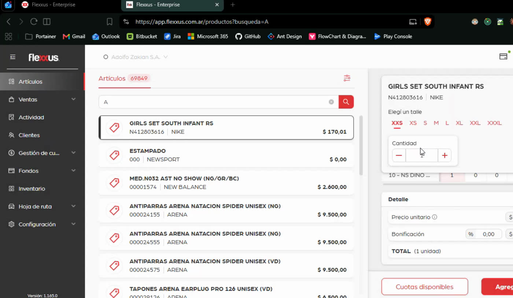
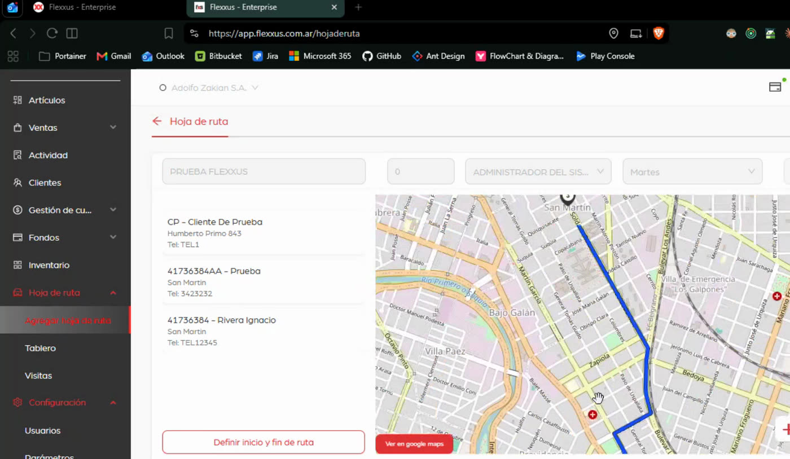

# Flexxus — Definición funcional de roles: Vendedor y Administrativo

> **Fecha:** 2026-10-22 · **Versión:** v1.0 preliminar, para validar con Flexxus en el roundup de intenciones
> **Autor:** Líder de Producto (intive)
> **Alcance:** las dos primeras intenciones analizadas del Discovery: **Vender en mostrador** (rol Vendedor, prioritaria) y **Gestionar y cerrar la venta** (rol Administrativo)
> **Documentos asociados:** [User flows (Mermaid)](2026-10-22-user-flows-vendedor-administrativo.md) · [PRD v3.0.0](../prd/PRD-flexxus-venta-stock-2026-10-22.md) · [Entregable de Producto v0.3](2026-10-22-entregable-producto-discovery.md)
> **Fuentes:** grabación de la demo del 21/10/2026 (47:36; carrito entre 15:30 y 23:15, perfiles entre 29:19 y 37:20); código de `flexxus-order` (frontend: `MainMenu`, `SidebarContent`, `HomePage`, `features/cart/domain/permissions`, `permissionDefaults.ts`); especificación `spec/carrito/` (README, `erp-permissions.md`, `erp-parameters.md`); fuentes Delphi (`frmFacturacion`, `uParametrosGenerales`)

Los minutos entre corchetes, por ejemplo [29:19], remiten a la grabación del 21/10. Los códigos de permiso son los del ERP, tal como los usa el código web.

---

## 0. Qué se acordó y qué propone este documento

En la demo del 21/10 se acordó avanzar con el flujo del usuario **Vendedor** como primera intención, y separar su experiencia de la del usuario **Administrativo** [30:12–33:11]. El propio Flexxus propuso «orientarlo más a procesos por perfil: cada perfil en su ambiente, con todo lo que necesita, y el que no lo tiene sigue dentro del ERP hasta que evolucione» [29:19].

Este documento propone:

- **El rol define la puerta de entrada.** El Vendedor entra a una **pantalla principal de venta** (dashboard + venta), sin el menú lateral ni las pestañas del ERP. El Administrativo entra al **menú lateral** con una bandeja de pendientes, sin la ventana de venta (ex carrito).
- **El carrito deja de ser un carrito de compras abierto como pestaña.** Pasa a ser la pantalla de trabajo del Vendedor: «Venta», a la que se llega desde su inicio.
- **Los permisos finos no cambian.** Siguen viniendo del perfil definido en el ERP, que la web ya lee al iniciar sesión [34:34–34:46]. Lo nuevo es un atributo que indica qué experiencia de inicio corresponde a cada perfil.

---

## 1. Cómo se usa hoy (lo que mostró la demo)

| Usuario hoy | Herramienta | Qué hace | Evidencia |
|---|---|---|---|
| Vendedor de salón | App ERP Web / POS | Arma presupuestos y pedidos que llegan a la caja; escanea códigos, consulta precio, stock y disponibilidad en otros locales; **no factura** | [20:59–21:21], [35:26–35:34] |
| Cajero | Facturador web (ERP Web / POS) o ERP Delphi | Factura y cobra; con perfil de cajero **solo emite facturas** | [20:35–20:52], [35:20–35:24] |
| Administración | ERP Delphi | Carga datos operativos (artículos, multiplazos) y procesos que la web no tiene | [20:08–20:24], [26:41] |
| Viajante | App mobile | Pedidos, cobros y cancelación de cuenta corriente con hoja de ruta y geolocalización | [35:44–36:57] |
| Usuario de consulta | App | Solo ve Artículos: stock, precios y descuentos aplicables | [34:10–34:32] |

- **Un mismo usuario no usa los dos sistemas.** «El cajero puede estar facturando con este y no abre jamás el ERP» [26:22–27:04]. Eso hace viable la coexistencia por perfil.
- **Hay tres circuitos de venta según el cliente:** presupuesto → pedido → factura; pedido → factura; factura directa [04:41–05:03].
- **Flexxus Order** (la demo en `10.250.0.98:7001`) copia «uno a uno» las pantallas del ERP [11:56–12:18] y no tiene clientes en producción [19:53]. El vendedor ve las pestañas Archivos, Ventas, Compras, Fondos, Stock, Configuración y Usuarios, además del menú lateral, y el carrito se abre como una pestaña más desde el ícono de la barra superior ([captura 1](#8-evidencia)).
- **El carrito unificado no existe en el ERP**: hay una pantalla por comprobante [18:56–19:17]. Es el único flujo con trabajo de UX, y viene de la app ERP Web / POS [15:30–16:14].
- **La home de Flexxus Order existe, pero con datos fijos de ejemplo** (`routes/HomePage/index.jsx`: «Clientes Nuevos 281», «Top Vendedores Markus Zukus»). No hay un servicio de indicadores detrás.

---

## 2. Principios de la propuesta

1. **Una intención, una puerta de entrada.** Lo primero que ve cada rol es su tarea principal, no el menú del sistema.
2. **Lo que no se usa no se muestra.** El Vendedor no ve módulos que no opera; el Administrativo no ve la venta de mostrador.
3. **Nada duplicado entre roles.** Cada acción tiene un único lugar por rol: el Vendedor emite desde «Venta» y el Administrativo gestiona desde el menú.
4. **Los valores por defecto hacen el trabajo.** Cliente por defecto (parámetro 87), depósito del usuario, lista, condición y tipo de comprobante por defecto del perfil: el Vendedor solo toca lo que cambia.
5. **La seguridad sigue en el perfil del ERP.** La experiencia por rol ordena la navegación; los permisos por comprobante y acción siguen siendo los mismos códigos.

---

## 3. Rol Vendedor (prioritario)

### 3.1 Definición

| Aspecto | Definición |
|---|---|
| **Quién es** | Quien atiende al cliente en el local: vendedor de mostrador o de salón, y cajero que vende y cobra |
| **Intención** | **Vender en mostrador:** pasar de «el cliente quiere comprar» a «comprobante emitido, cobrado y entregado» sin salir de su pantalla |
| **Frecuencia** | Decenas de operaciones por turno; cada segundo y cada clic cuentan |
| **Contexto fijo** | Sucursal, punto de venta, depósito y caja del usuario (la web ya los tiene: `checkout_name`, `warehouse_name`, `pos_name`, `aux_pos_name`) |
| **Variantes por permiso** | **Vendedor-cajero:** factura y cobra (permiso 002). **Vendedor de salón:** presupuestos y pedidos, sin facturar ni cobrar (003 y 004, sin 002). Las dos variantes comparten experiencia; cambia qué tipos de comprobante y qué acciones ven |
| **Fuera de este rol** | El viajante con hoja de ruta y el usuario de solo consulta: son otras intenciones del catálogo ([Entregable v0.3 §1](2026-10-22-entregable-producto-discovery.md)) |

### 3.2 Vistas a las que accede

| ID | Vista | Para qué | Cómo se llega | Origen hoy |
|---|---|---|---|---|
| **V-01** | **Inicio del vendedor** (dashboard) | Empezar una venta en un paso y ver lo pendiente del día | Al iniciar sesión | Nueva; reemplaza la home de ejemplo de Flexxus Order |
| **V-02** | **Venta** (ex carrito) | Armar la venta: cliente, artículos, condiciones y tipo de comprobante | «Nueva venta», buscador del inicio, o retomar una venta en curso | Carrito de ERP Web / POS y de Flexxus Order, reubicado |
| **V-03** | **Cobro** | Registrar los medios de pago y emitir | «Cobrar» desde Venta (FC y NP de contado) | Vista de medios de pago del carrito ([captura 3](#8-evidencia)) |
| **V-04** | **Comprobante emitido** | Imprimir, compartir, ver el pago, ticket de cambio, empezar otra venta | Al confirmar | Modal de resultado del carrito ([captura 4](#8-evidencia)) |
| **V-05** | **Consulta de artículo** | Precio, stock por depósito y otras sucursales, promociones y cuotas, sin vender | Buscador del inicio o desde Venta | Artículos de ERP Web / POS ([captura 7](#8-evidencia)) |
| **V-06** | **Mis comprobantes** | Los comprobantes propios del día o la semana: reimprimir, compartir, convertir un PR | Desde el inicio | Nueva vista acotada al usuario; hoy existen planillas de todos los usuarios |
| **V-07** | **Ficha rápida del cliente** | Datos, condición frente al IVA y, con permiso, saldo y límite de cuenta corriente | Desde Venta | Panel de cliente y saldos del carrito |

### 3.3 Propuesta de dashboard (V-01 · Inicio del vendedor)

Objetivo: que la primera acción posible sea vender, y que lo pendiente esté a la vista sin buscarlo en planillas.

```text
┌──────────────────────────────────────────────────────────────────────────────┐
│ Z1  Hola, Juan · Sucursal Centro · PV 0001 (electrónico) · Depósito 01 · Caja 2 │
├──────────────────────────────────────────────────────────────────────────────┤
│ Z2  [ 🔍 Buscá artículo, código de barras o cliente…          ]  [ + Nueva venta ] │
│     Iniciar como:  ( Factura )  ( Pedido )  ( Presupuesto )   ← solo los permitidos │
├───────────────────────────────┬──────────────────────────────────────────────┤
│ Z3  Ventas en curso (2)        │ Z4  Mi día                                    │
│     • Cliente 01 · 3 ítems     │     Vendido $ 245.300 · 18 comprobantes      │
│     • Consumidor final · 1 ítem│     Ticket promedio $ 13.627                 │
│                                │     Cobrado: efectivo · tarjeta · transfer.  │
├───────────────────────────────┼──────────────────────────────────────────────┤
│ Z5  Para accionar              │ Z6  Últimos comprobantes                      │
│     • 3 presupuestos vencen hoy│     FB 0001-00244422 · $1.140 · 🖨 ↗ ↺       │
│     • 2 pedidos sin facturar   │     NP 0000-00321163 · $2.420 · 🖨 ↗          │
│     • 1 factura sin CAE        │     …                     [ Ver todos → V-06 ]│
├───────────────────────────────┴──────────────────────────────────────────────┤
│ Z7  Clientes recientes: Cliente 01 · Cliente 03 · …     Z8  Avisos: caja abierta ✓ │
└──────────────────────────────────────────────────────────────────────────────┘
```

| Zona | Contenido | Por qué | Datos que necesita | Disponibilidad ⏳ a confirmar con Tecnología | Prioridad |
|---|---|---|---|---|---|
| **Z1** Contexto | Usuario, sucursal, punto de venta (electrónico o controlador fiscal), depósito y caja | El vendedor confirma dónde está vendiendo sin abrir menús | Datos de sesión del usuario | ✅ ya están en la sesión web | MVP |
| **Z2** Acción principal | Buscador único (artículo por código, descripción o barras, o cliente por nombre, código, DNI o CUIT) y «Nueva venta» con el tipo de comprobante. Solo se muestran los tipos que el perfil permite (002 a 005), con el marcado «por defecto» preseleccionado | Una sola entrada para las dos formas en que arranca una venta: «busco el producto» o «atiendo a este cliente» | Búsqueda de artículos y clientes; permisos por comprobante | ✅ búsquedas existentes; 🟡 permisos (hoy se cargan solo los del menú 78, PRD H-8) | MVP |
| **Z3** Ventas en curso | Ventas armadas y no emitidas, para retomarlas | Hoy el carrito persiste una sola venta en el navegador; en mostrador se atiende a más de un cliente a la vez | Persistencia de ventas abiertas | 🟡 hoy una sola venta en `localStorage` | MVP (una venta) / posterior (varias) |
| **Z4** Mi día | Monto vendido, cantidad de comprobantes, ticket promedio y cobrado por medio de pago del usuario | El vendedor sabe cómo va su turno; el cajero controla su caja | Comprobantes y cobros del usuario y del día | ❌ no hay servicio; la home actual es de ejemplo. Derivable de comprobantes y recibos | Posterior al MVP |
| **Z5** Para accionar | Presupuestos propios por vencer, pedidos propios sin facturar o sin entregar, comprobantes sin CAE o rechazados | Convierte lo pendiente en acciones en un clic, en lugar de buscarlo en planillas | Presupuestos con vencimiento, pedidos pendientes, estado de CAE, filtrados por usuario | 🟡 existen planillas de presupuestos y pedidos y la vista de factura electrónica, sin filtro por vendedor confirmado | MVP (CAE y pedidos) / posterior (resto) |
| **Z6** Últimos comprobantes | Los últimos 5 del usuario, con reimprimir, compartir y ticket de cambio | Es la acción más frecuente después de vender: «¿me lo reenviás?» | Comprobantes del usuario | 🟡 búsqueda de comprobantes existente (`/comprobantes`) | MVP |
| **Z7** Clientes recientes | Accesos directos a «Nueva venta para este cliente» | Clientes habituales de mostrador | Comprobantes recientes por cliente | 🟡 derivable | Posterior |
| **Z8** Avisos | Caja no abierta, punto de venta sin conexión con ARCA, cotización del día si vende en otra moneda | Evita descubrir el bloqueo recién al cobrar | Estado de caja, punto de venta y cotización | ⏳ a relevar | Posterior |

### 3.4 Funcionalidades y permisos

| Funcionalidad | Vendedor-cajero | Vendedor de salón | Permiso o parámetro del ERP | Regla que se preserva |
|---|---|---|---|---|
| Buscar artículo; ver precio, stock y promociones | ✅ | ✅ | 006 (ver listas de precio del artículo); parámetros 55, 109 | Stock real o remanente según el parámetro 109 (PRD H-14) |
| Ver stock en otras sucursales | ✅ | ✅ | ⏳ permiso a relevar | Mostrado en la app [21:14–21:21] |
| Emitir **Factura** | ✅ | ❌ | 002 (módulo 78), por defecto | CAE o controlador fiscal según el punto de venta [12:41–13:08] |
| Emitir **Pedido** (con reserva de stock según la operación) | ✅ | ✅ | 003 (módulo 87); 402 validación de CC | La operación define si compromete stock [09:14–09:21] |
| Emitir **Presupuesto** | ✅ | ✅ | 004 (módulo 90) | Sin efecto fiscal ni de stock; vencimiento por multiplazo [08:23–08:40] |
| Emitir **Nota de crédito** vinculada a una factura | 🟡 con permiso | ❌ | 005; 405 validación de CC | Propuesta: el vendedor la emite solo con permiso; si no, la solicita al Administrativo ([S-17](../prd/PRD-flexxus-venta-stock-2026-10-22.md#121-decisiones-abiertas--a-resolver-en-la-épica-1)) |
| Editar precio unitario | Con permiso | Con permiso | 11 (FC y NC, menú 78), 28 (NP, menú 87), 36 (PR, menú 90) | Precio pactado re-aplica (regla #1 del carrito) |
| Bonificar un ítem / bonificar al 100 % | Con permiso | Con permiso | 10 (FC), 27 (NP), 35 (PR), 260 (NC, menú 80) | Hoy el front no ve el permiso 260 (PRD H-8) |
| Descuento o interés general | Con permiso | Con permiso | 296 (FC), 295 (NP), 299 (PR), 297 (NC) | — |
| Validar cuenta corriente / destildar la validación | ✅ / solo con permiso | ✅ / solo con permiso | 404 (FC), 402 (NP), 405 (NC); 963 para destildar con el parámetro 287 activo | El presupuesto siempre valida (regla PR-6) |
| Retenciones globales | Con permiso | ❌ | 1064 | — |
| Cliente ocasional y edición rápida del cliente | ✅ | ✅ | Parámetro 94 (guardar cliente ocasional); ⏳ permiso de edición | Visto en la demo [17:21–17:30] |
| Cobrar: efectivo, tarjeta (Payway automático o POS manual con cupón), transferencia, cheque | ✅ | ❌ | Multiplazo y condición de venta; parámetro 58 | Descuento o recargo por medio de pago (efectivo −5 % en la demo); pagos confirmados externamente no se borran (regla #7) |
| Imprimir, compartir por WhatsApp o mail, ticket de cambio | ✅ | ✅ | — | — |
| Convertir un presupuesto propio en pedido o factura | ✅ | Solo a pedido | 003 / 002 | Circuitos PR → NP → FC [04:46–04:57] |
| Consultar el saldo de cuenta corriente del cliente en la venta | Con permiso | Con permiso | ⏳ permiso de consulta | El cajero típico no ve cuentas corrientes [35:38] |

### 3.5 Lo que el Vendedor no ve

- Las pestañas de módulo (Archivos, Compras, Fondos, Stock, Configuración, Usuarios) y el menú lateral completo.
- Libro IVA, planillas de comprobantes de todos los usuarios, facturación de pedidos en lote, notas de débito, remitos internos y de transferencia.
- Altas, bajas y modificaciones de artículos, listas de precio, multiplazos y parámetros.
- La gestión de cuentas corrientes (imputaciones, deudas totales, movimientos), salvo el saldo del cliente en la venta si tiene permiso.

---

## 4. Rol Administrativo

### 4.1 Definición

| Aspecto | Definición |
|---|---|
| **Quién es** | Back office de ventas: factura los pedidos que llegan del salón, emite notas de crédito y débito, gestiona remitos y cuentas corrientes y controla los libros |
| **Intención** | **Gestionar y cerrar la venta:** completar, corregir y controlar lo que generó el equipo de venta |
| **Frecuencia** | Procesos por lote y por consulta; menos operaciones, más volumen por operación |
| **Hoy** | Usa el ERP Delphi [26:41]; en Flexxus Order tiene el menú lateral que replica pantallas del ERP |
| **Fuera de este rol** | La venta de mostrador (no ve «Venta»); la administración del sistema (usuarios, perfiles, parámetros), que es otro rol del catálogo |

### 4.2 Vistas a las que accede

| ID | Vista | Para qué | Origen hoy |
|---|---|---|---|
| **V-11** | **Inicio administrativo** | Menú lateral + bandeja «Pendientes de gestión»: pedidos sin facturar, solicitudes de NC, comprobantes sin CAE, remitos sin facturar, deudas vencidas | Nueva; el menú lateral existe en Flexxus Order ([captura 6](#8-evidencia)) |
| **V-12** | Buscar comprobante | Encontrar cualquier comprobante de venta, verlo, reimprimirlo, ver pagos, vínculos y trazabilidad | Existe [06:19–06:27] |
| **V-13** | Facturación de pedidos | Seleccionar pedidos pendientes, de uno o varios clientes, y facturarlos | Existe en el menú Factura |
| **V-14** | Notas de crédito y débito | Crear NC vinculada a factura (o por solicitud del vendedor), ND, y sus planillas | Existe |
| **V-15** | Planillas de presupuestos y pedidos | Ver, autorizar, anular y convertir los de todos los vendedores | Existe |
| **V-16** | Remitos de venta | Emitir y consultar remitos; facturar remitos pendientes | Existe |
| **V-17** | Gestión de cuentas | Cuenta corriente (cobro e imputación de comprobantes), movimientos, deudas totales | Existe [23:16–25:08] |
| **V-18** | Libro IVA ventas | Consulta por período, filtros por letra, sucursal y punto de venta; libro IVA digital | Existe [05:51–06:09] |
| **V-19** | Consulta de artículos, clientes y stock | Datos de referencia; el alta y la modificación quedan en el ERP mientras no se migren | Parcial |

**Menú lateral propuesto del Administrativo (solo Venta y Stock):** Buscar comprobante · Ventas › Factura (Facturación de pedidos, Crear factura administrativa ⏳ [S-19](../prd/PRD-flexxus-venta-stock-2026-10-22.md#121-decisiones-abiertas--a-resolver-en-la-épica-1), Libro IVA ventas) · Nota de crédito · Nota de débito · Presupuestos (planilla) · Pedidos (planilla y autorización) · Remitos de venta · Gestión de cuentas (Cuenta corriente, Movimientos, Deudas totales) · Consultas (Artículos, Clientes, Stock).

### 4.3 Funcionalidades y permisos

| Funcionalidad | Administrativo | Permiso o parámetro del ERP | Nota |
|---|---|---|---|
| Facturar pedidos pendientes (uno o varios) | ✅ | 002 + 003; parámetro 116 si factura NP de otra empresa | Recibe los pedidos del vendedor de salón [21:02–21:06] |
| Emitir NC vinculada a factura; resolver solicitudes de NC | ✅ | 005; 405 | Reingreso de stock según la operación |
| Emitir ND | ✅ | ⏳ permiso a relevar | — |
| Autorizar o anular pedidos y presupuestos | ✅ | ⏳ permisos de planilla a relevar | En el Delphi existe la planilla de autorización de pedidos |
| Emitir y facturar remitos | ✅ | Parámetros 52, 82, 154 | Remito automático al facturar (PRD H-14) |
| Cobrar e imputar cuentas corrientes | ✅ | ⏳ permisos de gestión de cuentas | Selección de comprobantes y medios de pago [23:41–24:46] |
| Libro IVA y libro IVA digital | ✅ | ⏳ | — |
| Consultar artículos, clientes y stock | ✅ (lectura) | 006 | El alta y la modificación siguen en el ERP |
| Emitir una venta de mostrador desde «Venta» | ❌ | — | No ve la pantalla de venta ni el ícono de carrito |

### 4.4 Lo que el Administrativo no ve

- La pantalla «Venta» (ex carrito), el ícono de carrito de la barra superior y el inicio del vendedor.
- Compras, Fondos (salvo lo que toca la cobranza), Contabilidad, Producción, Configuración y Usuarios, que pertenecen a otros roles del catálogo.

---

## 5. Matriz rol × vista

| Vista / funcionalidad | Vendedor | Administrativo |
|---|---|---|
| Pantalla de inicio | **Inicio del vendedor** (V-01) | **Inicio administrativo** (V-11) |
| Navegación | Sin menú lateral; accesos desde el inicio | Menú lateral acotado a Venta y Stock |
| Venta (ex carrito) y cobro | ✅ | ❌ |
| Consulta de artículo (precio, stock, promociones) | ✅ | ✅ lectura |
| Comprobantes | Solo los propios (V-06) | Todos (V-12) |
| Facturación de pedidos | ❌ | ✅ |
| NC | Con permiso, o solicitud | ✅ |
| ND, remitos, libro IVA | ❌ | ✅ |
| Cuenta corriente | Saldo del cliente en la venta, con permiso | Gestión completa |
| Maestros (artículos, listas, multiplazos) | ❌ | Consulta; el ABM sigue en el ERP |

---

## 6. Cómo se asigna el rol

**Hoy:**

- Los perfiles se definen en el ERP; la web los levanta al iniciar sesión y restringe el menú [34:34–34:46].
- El menú web se arma dinámicamente con los ítems que el backend marca como disponibles para el usuario (`MainMenu`, `menuFetch` con `disponible`), sobre los procedimientos de permisos por usuario y menú del ERP.
- La sesión ya trae un campo `rol` que se muestra en el sidebar mobile (`SidebarContent.jsx`); ⏳ hay que confirmar qué contiene.
- Los tipos de comprobante habilitados son los permisos 002 a 005, y Factura viene habilitada por defecto si la base no tiene permisos cargados (`permissionDefaults.ts`).

**Propuesta:**

1. Agregar al perfil del ERP un atributo **«Experiencia de inicio»** con dos valores: Vendedor o Administrativo. El atributo decide la pantalla de inicio y la navegación; no reemplaza ningún permiso.
2. Mientras el atributo no exista, inferirlo: un perfil con al menos un permiso de comprobante (002 a 005) y sin ítems de menú administrativos es **Vendedor**; el resto es **Administrativo** ([S-15](../prd/PRD-flexxus-venta-stock-2026-10-22.md#121-decisiones-abiertas--a-resolver-en-la-épica-1)).
3. Un usuario que necesita las dos experiencias (encargado de local) cambia de modo con un selector visible solo con permiso, sin mezclar navegaciones ([S-16](../prd/PRD-flexxus-venta-stock-2026-10-22.md#121-decisiones-abiertas--a-resolver-en-la-épica-1)).
4. Cargar los permisos de todos los menús que usa la venta (78, 80, 87 y 90), no solo el 78 (PRD H-8).

---

## 7. Decisiones abiertas de este documento

Viven en el [PRD v3.0.0 §12.1](../prd/PRD-flexxus-venta-stock-2026-10-22.md#121-decisiones-abiertas--a-resolver-en-la-épica-1):

- **S-15:** cómo se asigna el rol (atributo nuevo o inferencia).
- **S-16:** usuarios con los dos roles.
- **S-17:** si el vendedor emite NC o solo la solicita.
- **S-18:** qué indicadores muestra el dashboard y de qué fuente salen.
- **S-19:** si el Administrativo crea facturas sin pedido previo.
- **S-02:** sobre qué producto se construye, ERP Web / POS o Flexxus Order.
- **S-21:** si las intenciones que relevaron Fer y Ale en Flexxus coinciden con estas dos.

---

## 8. Evidencia

| # | Captura | Qué muestra |
|---|---|---|
| 1 |  | El carrito se abre como pestaña junto a otras pantallas, con el menú completo del ERP arriba y a la izquierda [15:32] |
| 2 |  | El aviso de stock llega como confirmación después de agregar el artículo (parámetro 109 en modo aviso) [17:35] |
| 3 |  | Medios de pago con descuento del 5 % en efectivo [17:38] |
| 4 |  | Resultado: factura, recibo, pagos asociados, ticket de cambio [17:56] |
| 5 |  | Cobro con tarjeta automático (Payway) o manual (POS físico y cupón) [03:12] |
| 6 |  | Menú lateral de Flexxus Order y cuenta corriente con límite y saldo disponible [25:22] |
| 7 |  | Consulta de artículos de la app: talles, stock por depósito, cuotas disponibles [34:49] |
| 8 |  | Hoja de ruta del viajante, otra intención del catálogo [36:47] |
