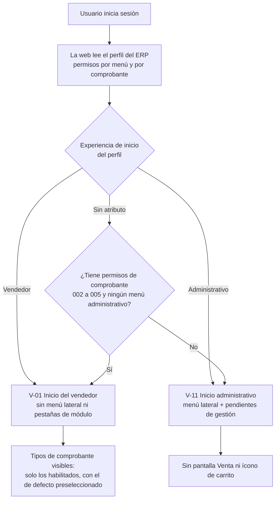
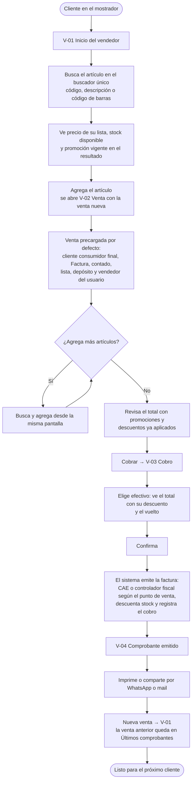
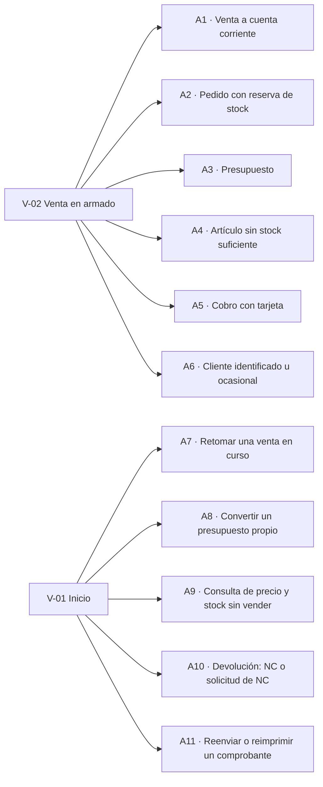
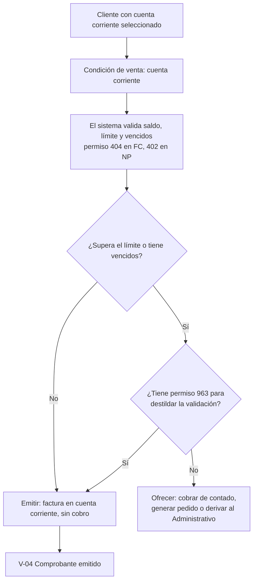
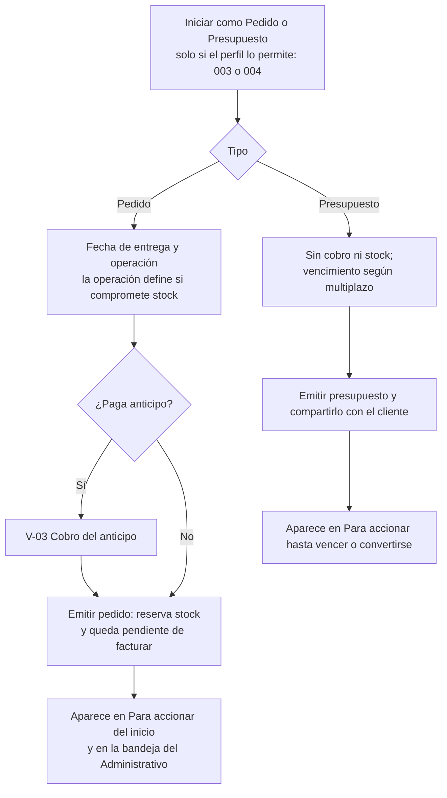
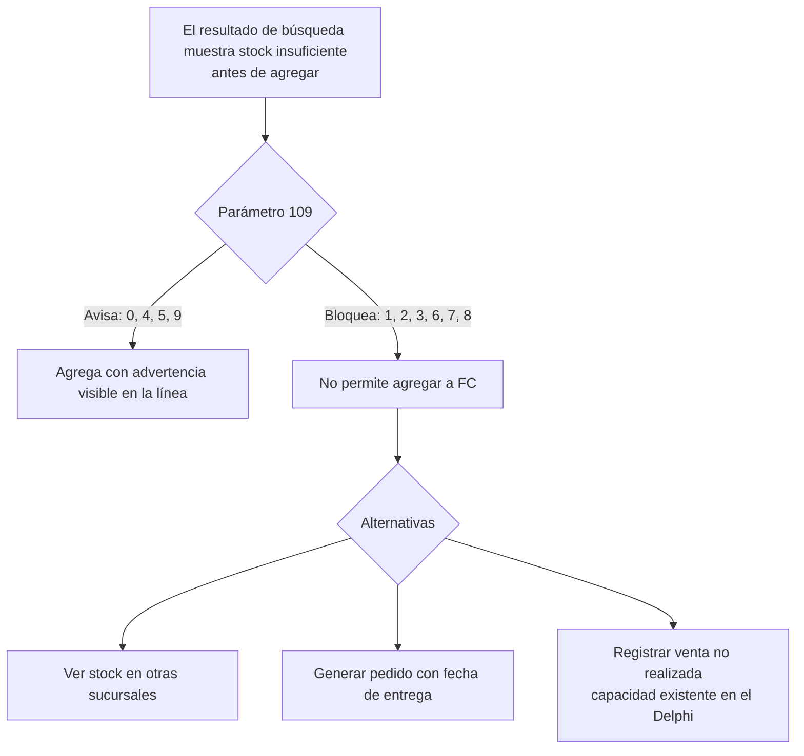
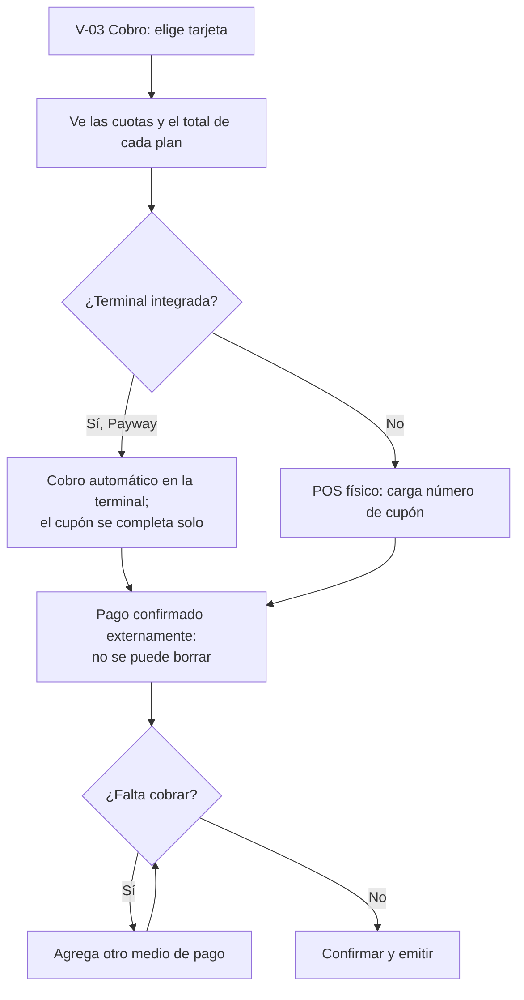
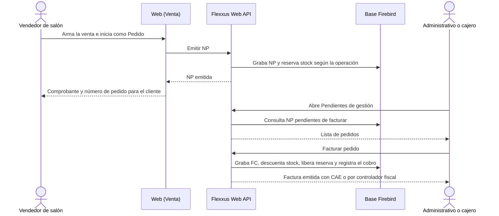
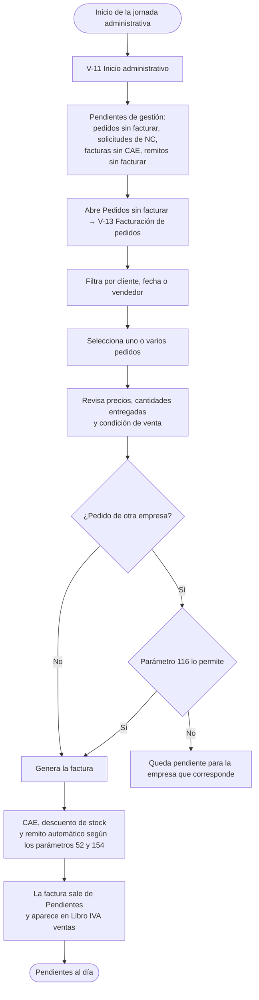
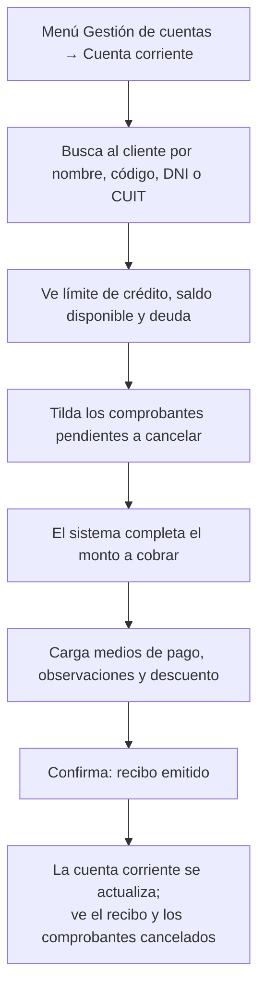

# Flexxus — User flows: Vendedor y Administrativo (happy paths y alternativos)

> **Fecha:** 2026-10-22 · **Versión:** v1.0 preliminar
> **Autor:** Líder de Producto (intive)
> **Documentos asociados:** [Definición de roles](2026-10-22-roles-vendedor-administrativo.md) · [PRD v3.0.0](../prd/PRD-flexxus-venta-stock-2026-10-22.md) · [Entregable de Producto v0.3](2026-10-22-entregable-producto-discovery.md)

Los diagramas describen la **experiencia objetivo propuesta**, no la actual. Los IDs de vista (V-nn) son los de la [definición de roles](2026-10-22-roles-vendedor-administrativo.md); los de requerimiento (RF-nn), los del PRD. Los minutos entre corchetes remiten a la grabación del 21/10.

---

## 1. Entrada a la plataforma según el rol

| Paso | Regla | Referencia |
|---|---|---|
| Lectura del perfil | El perfil se define en el ERP y la web lo levanta al iniciar sesión | [34:34–34:46]; RF-28 |
| Experiencia de inicio | Atributo nuevo del perfil; mientras no exista, se infiere | RF-29, S-15 |
| Tipos visibles | Permisos 002 (FC, por defecto), 003 (NP), 004 (PR), 005 (NC) | RF-31 |

---

## 2. Vendedor — happy path: venta de mostrador con factura de contado

Escenario: un cliente consumidor final compra un artículo en el local, paga en efectivo y se lleva la factura.

| # | Paso | Qué ve y hace el Vendedor | Qué resuelve el sistema | Cambio respecto de hoy | RF |
|---|---|---|---|---|---|
| 1 | Inicio | Contexto (sucursal, PV, depósito, caja) y buscador | Lee perfil y contexto del usuario | Hoy entra a una home de ejemplo o al menú completo | RF-29, RF-32 |
| 2 | Buscar | Escribe o escanea | Busca por código, descripción y barras (parámetros 32, 150) | Hoy la búsqueda abre un modal «Resultados de tu búsqueda» y pide «Seleccionar» [17:26] | RF-01, RF-36 |
| 3 | Ver precio y stock | Precio, stock disponible y promoción en el mismo resultado | Precio por lista y pactado; stock real o remanente según el parámetro 109; promociones del motor | Hoy el aviso de stock llega como modal después de agregar [17:35] | RF-02, RF-03, RF-25, RF-37 |
| 4 | Agregar | Un clic; cantidad, talle o lote si corresponde | Valida talle o lote (parámetros 20, 83) | — | RF-04 |
| 5 | Venta precargada | No completa nada si es el caso típico | Cliente por defecto (parámetro 87), tipo de comprobante por defecto del perfil, depósito y lista del usuario | Hoy el panel derecho muestra siempre Enviar como, Lista, Condición de venta y de pago, Depósito, Vendedor, Descuento y Más detalles | RF-38 |
| 6 | Revisar total | Total final con promociones, bonificaciones y descuentos | Motor de promociones y percepciones | — | RF-25, RF-26 |
| 7 | Cobrar | Elige el medio de pago y ve el total con descuento o recargo de ese medio | Descuento por medio de pago del multiplazo | Hoy el −5 % en efectivo aparece recién en el cobro [17:38]; se propone mostrarlo antes | RF-18, RF-39 |
| 8 | Confirmar | Un botón | Comprobante, stock y cobro atómicos; bloqueo de la pantalla mientras graba | — | RF-08, RF-13, RF-24, RNF-02 |
| 9 | Comprobante emitido | Imprimir, compartir, ticket de cambio, ver el pago | Reporteador, WhatsApp, mail | Existe [17:56] | RF-12 |
| 10 | Nueva venta | Vuelve al inicio con la venta vacía | Reset a comprobante nuevo con el cliente del parámetro 87 | Hoy vuelve al carrito vacío | RF-40 |

---

## 3. Vendedor — flujos alternativos

### 3.1 A1 · Venta a cuenta corriente

### 3.2 A2 · Pedido con reserva de stock y A3 · Presupuesto

### 3.3 A4 · Artículo sin stock suficiente

### 3.4 A5 · Cobro con tarjeta

| Flujo | Disparador | Regla clave | Prioridad | RF |
|---|---|---|---|---|
| **A1** Cuenta corriente | Cliente con CC y condición CC | Permisos 402/404/405, 963 con parámetro 287 | MVP | RF-20, RF-41 |
| **A2** Pedido | Tipo Pedido permitido | La operación define la reserva de stock [09:14]; NP validada según el parámetro 109 (5 a 9) | MVP | RF-14, RF-42 |
| **A3** Presupuesto | Tipo Presupuesto permitido | Sin stock ni fiscal; siempre valida CC (PR-6) | MVP | RF-06, RF-42 |
| **A4** Sin stock | Stock menor a la cantidad | Parámetro 109; alternativas: otra sucursal, pedido, VNR | MVP (aviso y bloqueo) / posterior (VNR) | RF-14, RF-43 |
| **A5** Tarjeta | Medio tarjeta | Automático (Payway) o manual con cupón [05:18–05:34]; pagos externos no se borran | MVP | RF-18, RF-39 |
| **A6** Cliente | Venta a cliente identificado u ocasional | Parámetro 94; CUIT obligatorio sobre el umbral de la sucursal | MVP | RF-10, RF-11 |
| **A7** Retomar venta | Venta en curso en el inicio | Persistencia de la venta abierta | MVP (una) / posterior (varias) | RF-44 |
| **A8** Convertir presupuesto | Presupuesto propio en Para accionar | Copia el contenido según la parametrización | MVP | RF-07, RF-45 |
| **A9** Consulta | Buscador del inicio, sin vender | Precio, stock por depósito y sucursal, promociones, cuotas | MVP | RF-03, RF-46 |
| **A10** Devolución | Cliente devuelve | NC vinculada a la factura con permiso 005, o solicitud al Administrativo | Posterior al MVP ⏳ S-17 | RF-09, RF-47 |
| **A11** Reenviar | Últimos comprobantes | Reimprimir, compartir, ticket de cambio | MVP | RF-12 |

---

## 4. Traspaso Vendedor de salón → Administrativo (o cajero)

Es el circuito que la demo describe para los clientes que separan venta y facturación [20:59–21:06].

---

## 5. Administrativo — happy path: facturar los pedidos del día

## 6. Administrativo — happy path secundario: cobrar e imputar una cuenta corriente

| Flujo | Paso crítico | Fuente | RF |
|---|---|---|---|
| Facturar pedidos | Selección múltiple y regla del parámetro 116 | Delphi «Facturación de Pedidos»; NR 04.11 | RF-48, RF-27 |
| Pendientes de gestión | Bandeja con contadores accionables | Propuesta nueva | RF-49 |
| Cobrar CC | Selección de comprobantes y cálculo del monto | Demo [23:41–24:46] | RF-50 |
| NC por solicitud | Resolver la solicitud del vendedor | Delphi «Solicitud Nota de Crédito» | RF-51 |
